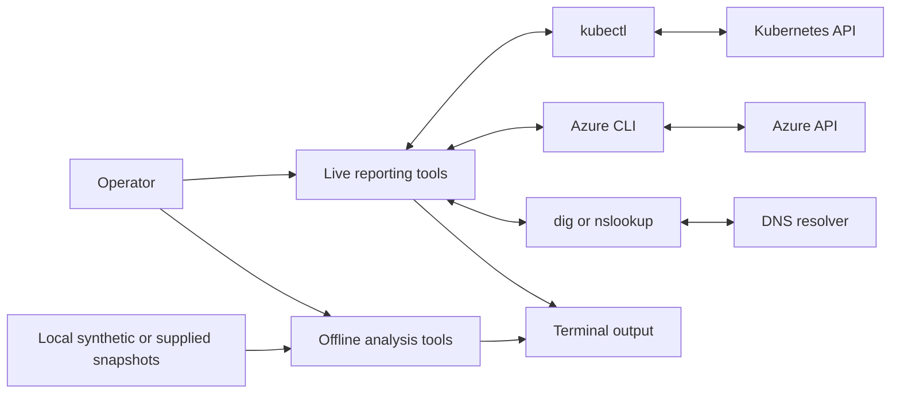

# Kubernetes Engineering Toolkit

A personal collection of small, read-only tools for inspecting Kubernetes clusters and troubleshooting common workload issues.

These are independently written, general-purpose adaptations of operational workflows from the local `toolkit` repository. All bundled examples use synthetic data; no internal endpoints, credentials, or production values are included. They do not read Kubernetes `Secret` objects or modify cluster resources. Command output can still contain environment-specific names and metadata; review it before sharing.

## How It Works



## Requirements

- Bash 3.2 or newer
- Python 3.9 or newer for offline JSON analyzers
- PowerShell 5.1 or newer for the offline AKS inventory report
- `ansible-core` to run the local GSLB report
- `kubectl` configured for the cluster you intend to inspect
- Read permissions for the resources queried by each script
- Azure CLI (`az`) for the AKS node-pool report

## Tools

### Cluster snapshot

Show the active context, nodes, namespaces, and pending or failed pods:

```bash
bash cluster-snapshot/cluster-snapshot.sh
```

### Duplicate node addresses

Inspect node `InternalIP` or `ExternalIP` assignments in an explicitly named context, or use the current context:

```bash
python3 duplicate-node-addresses/check_duplicate_node_addresses.py --context <context-name>
python3 duplicate-node-addresses/check_duplicate_node_addresses.py --address-type ExternalIP --format json
```

The report includes node names and addresses, which are operational metadata. Review it before sharing.

### Pods per node

Summarize a local Kubernetes snapshot without loading kubeconfig or calling the Kubernetes API:

```bash
python3 pods-per-node/pods_per_node.py
python3 pods-per-node/pods_per_node.py --input pods-per-node/examples/pods.json --format json
```

### Namespace label selector

List namespaces matching a required label selector without hard-coded organization labels:

```bash
bash label-selector-report/label-selector-report.sh --selector 'team=demo'
bash label-selector-report/label-selector-report.sh --selector 'team=demo' --context <context-name>
```

### Pod triage

List pods and warning events across namespaces, or narrow the output to one namespace:

```bash
bash pod-triage/pod-triage.sh
bash pod-triage/pod-triage.sh <namespace>
```

### Pod disruption budgets

Review disruption budgets and allowed disruptions across the cluster, or for one namespace:

```bash
bash pdb-report/pdb-report.sh
bash pdb-report/pdb-report.sh <namespace>
```

### Offline cluster health

Review a synthetic or sanitized TSV snapshot of deployments, pods, and node conditions without connecting to a cluster:

```bash
bash offline-cluster-health/cluster-health-summary.sh
bash offline-cluster-health/cluster-health-summary.sh ./offline-cluster-health/examples/cluster-health.tsv
```

### DNS lookup

Check A and AAAA records through the system resolver or a specified DNS server:

```bash
bash dns-check/dns-check.sh example.test
bash dns-check/dns-check.sh example.test 192.0.2.53
```

The DNS utility uses `dig` when available and falls back to `nslookup`. Replace these documentation placeholders with a resolvable hostname and DNS server.

### AKS node pools

List node-pool provisioning state and configuration for one explicitly selected cluster:

```bash
bash aks-nodepool-report/aks-nodepool-report.sh --resource-group <resource-group> --cluster <cluster-name>
bash aks-nodepool-report/aks-nodepool-report.sh --resource-group <resource-group> --cluster <cluster-name> --subscription <subscription-id>
```

The report passes the subscription directly to Azure CLI and does not change the active Azure subscription.

### Offline cluster triage

Analyze a local JSON snapshot. The default example is synthetic; this tool does not connect to Kubernetes:

```bash
python3 kube-triage/cluster_health.py
python3 kube-triage/cluster_health.py --format json
```

### Spegel health

Evaluate mirror health from a local synthetic or sanitized JSON snapshot:

```bash
python3 spegel-health/spegel_health.py
python3 spegel-health/spegel_health.py --format json
```

### Argo CD health

Summarize application sync/health and controller readiness from a local snapshot:

```bash
python3 argocd-health/argocd_health.py
python3 argocd-health/argocd_health.py --format json
```

### RKE2 etcd health

Review quorum, database utilization, fsync latency, and pending proposals from synthetic or sanitized metrics:

```bash
python3 rke2-etcd-health/etcd_health.py
python3 rke2-etcd-health/etcd_health.py --format json
```

### AVI / AMKO report

Review synthetic GSLB site, pool, and host-rule health without contacting a controller:

```bash
python3 avi-amko-report/avi_amko_report.py
python3 avi-amko-report/avi_amko_report.py --format json
```

### VMware inventory

Summarize VM power, guest-tools, snapshot-age, and datastore utilization signals from a local snapshot:

```bash
python3 vmware-inventory/vmware_inventory.py
python3 vmware-inventory/vmware_inventory.py --format json
```

### Ansible run summary

Summarize task result counts from a local sanitized JSON report:

```bash
python3 ansible-run-summary/ansible_run_summary.py
python3 ansible-run-summary/ansible_run_summary.py --format json
```

### PowerShell AKS inventory

Summarize cluster and node-pool metadata from a local JSON snapshot without Azure CLI or Az modules:

```powershell
./powershell-aks-inventory/aks_inventory_report.ps1
./powershell-aks-inventory/aks_inventory_report.ps1 -Format json
```

### Ansible GSLB report

Filter a local snapshot for rejected GSLB host rules; this playbook runs on localhost and sends no notifications:

```bash
ansible-playbook ansible-gslb-report/gslb_rule_report.yml
```

### Kong config check

Check synthetic declarative gateway configuration for duplicate routes and unresolved service references:

```bash
python3 kong-config-check/kong_config_check.py
python3 kong-config-check/kong_config_check.py --format json
```

The live Kubernetes scripts only issue read-only `kubectl get` and local kubeconfig context commands. The AKS report only lists node pools. Offline analyzers read local input only. None of the tools modify infrastructure or save output to files.

## Report contract

Offline health analyzers use `HEALTHY`, `WARNING`, or `CRITICAL` in JSON. Their process exits with `0` when no actionable findings exist (`INFO` findings are allowed), `1` when findings need attention, and `2` for invalid arguments or input. A report describes only the supplied snapshot; it is not proof of current live-system health. The Ansible summary exits `1` for failed or unreachable hosts.

## Porting scope

These are original, read-only adaptations of reporting and troubleshooting workflows in `toolkit`, including Kubernetes health checks, pod-per-node discovery, AKS inventory, and GSLB monitoring. Source workflows that retrieve credentials, expose internal endpoints, or mutate resources were excluded. All included fixtures are synthetic. No Terraform or Kong port was derived from source because those folders are placeholders; the existing Kong configuration check is an original offline utility. No source credentials or production data were copied.

## Safety

- Confirm `kubectl config current-context` before running a tool.
- Treat output as potentially sensitive operational metadata; do not commit real cluster output.
- These scripts do not retrieve, print, or decode secret values.
- Review permissions and test against a non-production cluster before adapting the tools.

## Development

Check shell syntax without connecting to a cluster:

```bash
bash -n */*.sh
python3 -m py_compile kube-triage/cluster_health.py
python3 -m py_compile spegel-health/spegel_health.py
python3 -m py_compile argocd-health/argocd_health.py rke2-etcd-health/etcd_health.py
python3 -m py_compile avi-amko-report/avi_amko_report.py
python3 -m py_compile vmware-inventory/vmware_inventory.py
python3 -m py_compile ansible-run-summary/ansible_run_summary.py
python3 -m py_compile kong-config-check/kong_config_check.py
python3 -m py_compile duplicate-node-addresses/check_duplicate_node_addresses.py
python3 -m py_compile pods-per-node/pods_per_node.py
pwsh -NoLogo -NoProfile -File powershell-aks-inventory/aks_inventory_report.ps1 -Format json
ruby -e 'require "yaml"; ARGV.each { |file| YAML.load_file(file); puts "#{file}: valid YAML" }' ansible-gslb-report/gslb_rule_report.yml ansible-gslb-report/examples/gslb-host-rules.yml
bash -n offline-cluster-health/cluster-health-summary.sh
```